<p align="center">
  <a href="https://github.com/Gabriel-SZ-Silva/classificadores-6-datasets/actions/workflows/ci.yml"></a>
  <a href="LICENSE"></a>
  <a href="https://www.python.org/"></a>
  <a href="https://colab.research.google.com/github/Gabriel-SZ-Silva/classificadores-6-datasets/blob/main/notebooks/classificadores_6_datasets.ipynb"></a>
</p>

# Classificadores em 6 datasets

Comparação de **SVM, Decision Tree, Random Forest e Gradient Boosting** em seis datasets de classificação, com busca de hiperparâmetros por validação cruzada, avaliação por **acurácia, precisão, recall, F1, curva ROC/AUC e matriz de confusão**, e um **diagnóstico de viés e variância** que justifica a escolha entre Random Forest e Gradient Boosting em cada dataset.

Os quatro classificadores ficam num único dicionário e passam pelo mesmo laço `for`. O mesmo código roda como pacote Python, pela linha de comando ou como notebook no Google Colab, e gera tabelas, figuras e um painel HTML com todos os resultados.

> **[Abrir o notebook no Colab](https://colab.research.google.com/github/Gabriel-SZ-Silva/classificadores-6-datasets/blob/main/notebooks/classificadores_6_datasets.ipynb)**, sem instalação.

---

## Sumário

- [Destaques](#destaques)
- [Resultados](#resultados)
- [Painel](#painel)
- [Arquitetura](#arquitetura)
- [Pipeline](#pipeline)
- [Metodologia](#metodologia)
- [Datasets](#datasets)
- [Instalação](#instalação)
- [Uso](#uso)
- [Estrutura do projeto](#estrutura-do-projeto)
- [Testes e qualidade](#testes-e-qualidade)
- [Limitações](#limitações)
- [Licença](#licença)

---

## Destaques

- **6 datasets, 4 modelos, o mesmo laço.** SVM, Decision Tree, Random Forest e Gradient Boosting ficam num dicionário e passam pelo mesmo `for`, com busca de hiperparâmetros (`RandomizedSearchCV`) em validação cruzada estratificada de 5 folds.
- **SVM teve o melhor F1 no teste em 4 dos 6 datasets:** Câncer de Mama (0.981, com ROC AUC 0.997), Estresse Estudantil (0.889), Eleições (0.791) e Fishmorph (0.727). O Random Forest venceu em Cardiopatia (0.884) e o Gradient Boosting em Pokémon (0.249). Na média dos seis, SVM (0.738) e Random Forest (0.736) ficam praticamente empatados, à frente do Gradient Boosting (0.722) e da árvore isolada (0.667).
- **Viés e variância medidos, não supostos.** Eleições, Fishmorph e Pokémon têm alta variância nos dois ensembles. Cardiopatia e Estresse têm diagnóstico misto, com só o Gradient Boosting superajustando. Câncer de Mama está equilibrado. Nos ensembles não houve alto viés; só a árvore isolada do Pokémon não ajusta bem nem o treino (F1 de treino 0.630).
- **Random Forest x Gradient Boosting:** Random Forest em 4 datasets (Fishmorph, Cardiopatia, Estresse e Pokémon), Gradient Boosting em 2 (Câncer de Mama e Eleições). Nas seis comparações a diferença de F1 ficou dentro do desvio-padrão entre os folds, e o desempate foi pelo menor gap. Em Eleições a evidência contrariou a teoria: o Gradient Boosting controlou a variância melhor que o Random Forest.
- **O ensemble certo reduz a variância da árvore:** no Fishmorph, o Random Forest baixou o gap de 0.472 (árvore isolada) para 0.290 e subiu o F1 de validação de 0.495 para 0.641.
- **Métricas completas:** acurácia, precisão, recall, F1, ROC AUC (binária ou macro um-contra-todos) e matriz de confusão, no teste e na validação cruzada.
- **Reprodutível:** um comando (`python -m classificadores executar`) baixa os dados, treina, avalia e gera CSVs, figuras e um [painel HTML](#painel). O mesmo código roda [no Colab](notebooks/classificadores_6_datasets.ipynb), e 20 testes automatizados rodam no GitHub Actions.

---

## Resultados

Conjunto de teste: 20% de cada dataset, separado antes de qualquer ajuste e usado uma única vez. Validação cruzada: 5 folds estratificados sobre os 80% de treino.

<!-- RESULTADOS:INICIO -->

> Tabelas geradas automaticamente por `scripts/atualizar_readme.py` a partir de [`resultados/`](resultados/). Em negrito, o melhor modelo de cada dataset. Precisão, recall e F1 são médias macro.

#### F1 no teste

| Dataset | Decision Tree | Random Forest | Gradient Boosting | SVM |
|---|:---:|:---:|:---:|:---:|
| Câncer de Mama | 0.877 | 0.962 | 0.952 | **0.981** |
| Eleições (Literary Digest) | 0.688 | 0.757 | 0.721 | **0.791** |
| Fishmorph (Ordem) | 0.548 | 0.703 | 0.680 | **0.727** |
| Cardiopatia | 0.820 | **0.884** | 0.868 | 0.862 |
| Estresse Estudantil | 0.875 | 0.887 | 0.863 | **0.889** |
| Ultimate Pokémon | 0.191 | 0.219 | **0.249** | 0.179 |

#### ROC AUC no teste

| Dataset | Decision Tree | Random Forest | Gradient Boosting | SVM |
|---|:---:|:---:|:---:|:---:|
| Câncer de Mama | 0.896 | 0.996 | 0.993 | **0.997** |
| Eleições (Literary Digest) | 0.815 | 0.822 | **0.861** | 0.827 |
| Fishmorph (Ordem) | 0.788 | 0.978 | **0.982** | 0.969 |
| Cardiopatia | 0.889 | 0.927 | 0.913 | **0.931** |
| Estresse Estudantil | 0.964 | **0.985** | 0.982 | 0.984 |
| Ultimate Pokémon | 0.616 | **0.781** | 0.774 | 0.750 |

#### Acurácia no teste

| Dataset | Decision Tree | Random Forest | Gradient Boosting | SVM |
|---|:---:|:---:|:---:|:---:|
| Câncer de Mama | 0.886 | 0.965 | 0.956 | **0.982** |
| Eleições (Literary Digest) | 0.690 | 0.759 | 0.724 | **0.793** |
| Fishmorph (Ordem) | 0.627 | 0.758 | 0.799 | **0.809** |
| Cardiopatia | 0.821 | **0.886** | 0.870 | 0.864 |
| Estresse Estudantil | 0.873 | **0.886** | 0.864 | **0.886** |
| Ultimate Pokémon | 0.229 | 0.288 | **0.307** | 0.224 |

#### Precisão no teste

| Dataset | Decision Tree | Random Forest | Gradient Boosting | SVM |
|---|:---:|:---:|:---:|:---:|
| Câncer de Mama | 0.879 | 0.967 | 0.961 | **0.986** |
| Eleições (Literary Digest) | 0.715 | 0.757 | 0.721 | **0.791** |
| Fishmorph (Ordem) | 0.534 | 0.677 | 0.766 | **0.789** |
| Cardiopatia | 0.820 | **0.885** | 0.868 | 0.863 |
| Estresse Estudantil | 0.885 | 0.889 | 0.864 | **0.916** |
| Ultimate Pokémon | 0.198 | 0.234 | **0.268** | 0.174 |

#### Recall no teste

| Dataset | Decision Tree | Random Forest | Gradient Boosting | SVM |
|---|:---:|:---:|:---:|:---:|
| Câncer de Mama | 0.875 | 0.957 | 0.945 | **0.976** |
| Eleições (Literary Digest) | 0.704 | 0.760 | 0.721 | **0.791** |
| Fishmorph (Ordem) | 0.585 | **0.771** | 0.631 | 0.694 |
| Cardiopatia | 0.824 | **0.884** | 0.868 | 0.862 |
| Estresse Estudantil | 0.873 | **0.887** | 0.864 | 0.886 |
| Ultimate Pokémon | 0.195 | 0.229 | **0.252** | 0.192 |

#### F1 na validação cruzada (média dos folds)

| Dataset | Decision Tree | Random Forest | Gradient Boosting | SVM |
|---|:---:|:---:|:---:|:---:|
| Câncer de Mama | 0.937 | 0.960 | 0.967 | **0.974** |
| Eleições (Literary Digest) | **0.842** | 0.795 | 0.806 | 0.805 |
| Fishmorph (Ordem) | 0.495 | **0.641** | 0.621 | 0.638 |
| Cardiopatia | 0.828 | 0.856 | **0.867** | 0.851 |
| Estresse Estudantil | 0.885 | 0.886 | **0.887** | 0.883 |
| Ultimate Pokémon | 0.201 | **0.252** | 0.246 | 0.238 |

### Viés e variância

Gap = F1 de treino − F1 de validação, nos folds da validação cruzada. Acima de 0.10: alta variância (overfitting). F1 de treino abaixo de 0.80: alto viés (underfitting).

| Dataset | Decision Tree | Random Forest | Gradient Boosting | SVM |
|---|:---:|:---:|:---:|:---:|
| Câncer de Mama | Equilibrado (gap 0.047) | Equilibrado (gap 0.036) | Equilibrado (gap 0.033) | Equilibrado (gap 0.008) |
| Eleições (Literary Digest) | Equilibrado (gap 0.069) | Alta variância (overfitting) (gap 0.205) | Alta variância (overfitting) (gap 0.153) | Equilibrado (gap 0.084) |
| Fishmorph (Ordem) | Alta variância (overfitting) (gap 0.472) | Alta variância (overfitting) (gap 0.290) | Alta variância (overfitting) (gap 0.379) | Alta variância (overfitting) (gap 0.294) |
| Cardiopatia | Equilibrado (gap 0.026) | Equilibrado (gap 0.046) | Alta variância (overfitting) (gap 0.133) | Equilibrado (gap 0.004) |
| Estresse Estudantil | Equilibrado (gap 0.012) | Equilibrado (gap 0.099) | Alta variância (overfitting) (gap 0.113) | Alta variância (overfitting) (gap 0.117) |
| Ultimate Pokémon | Viés e variância altos (gap 0.429) | Alta variância (overfitting) (gap 0.727) | Alta variância (overfitting) (gap 0.754) | Alta variância (overfitting) (gap 0.653) |

<p align="center">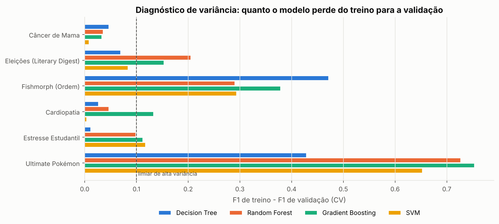</p>

### Random Forest x Gradient Boosting

Decide o F1 da validação cruzada; quando a diferença é menor que o desvio-padrão entre os folds (empate técnico), vence o modelo de menor gap.

| Dataset | Problema (RF e GB) | F1 CV RF | F1 CV GB | Desvio | Gap RF | Gap GB | Escolha |
|---|---|:---:|:---:|:---:|:---:|:---:|---|
| Câncer de Mama | Equilibrado | 0.960 | 0.967 | 0.016 | 0.036 | 0.033 | **Gradient Boosting** |
| Eleições (Literary Digest) | Alta variância (overfitting) | 0.795 | 0.806 | 0.072 | 0.205 | 0.153 | **Gradient Boosting** |
| Fishmorph (Ordem) | Alta variância (overfitting) | 0.641 | 0.621 | 0.034 | 0.290 | 0.379 | **Random Forest** |
| Cardiopatia | Misto (um modelo superajusta, o outro não) | 0.856 | 0.867 | 0.040 | 0.046 | 0.133 | **Random Forest** |
| Estresse Estudantil | Misto (um modelo superajusta, o outro não) | 0.886 | 0.887 | 0.026 | 0.099 | 0.113 | **Random Forest** |
| Ultimate Pokémon | Alta variância (overfitting) | 0.252 | 0.246 | 0.033 | 0.727 | 0.754 | **Random Forest** |

<details>
<summary>Justificativa completa de cada dataset</summary>

**Câncer de Mama.** O dataset está **equilibrado**: os dois ensembles generalizam bem (gap de 0.036 no Random Forest e 0.033 no Gradient Boosting), sem sinal de viés nem de variância altos. Como linha de base, a árvore de decisão isolada teve F1 de validação 0.937 (gap 0.047); o Random Forest chegou a 0.960 e o Gradient Boosting a 0.967. A diferença de F1 entre os dois (0.007) é menor que o desvio-padrão entre os folds (0.016), um empate técnico. O critério de desempate é a estabilidade: o **Gradient Boosting** tem o menor gap (0.033 contra 0.036). A curva de aprendizado do Gradient Boosting já está estável: mais dados do mesmo tipo ajudariam pouco.

**Eleições (Literary Digest).** O dataset tem **alta variância**: os dois ensembles ajustam o treino muito melhor que a validação (gap de 0.205 no Random Forest e 0.153 no Gradient Boosting). Na teoria, é o caso do Random Forest, cuja média de árvores reduz variância. Como linha de base, a árvore de decisão isolada teve F1 de validação 0.842 (gap 0.069); o Random Forest chegou a 0.795 e o Gradient Boosting a 0.806. A diferença de F1 entre os dois (0.011) é menor que o desvio-padrão entre os folds (0.072), um empate técnico. O critério de desempate é a estabilidade: o **Gradient Boosting** tem o menor gap (0.153 contra 0.205). A evidência contraria a teoria: com os hiperparâmetros encontrados (taxa de aprendizado, profundidade, regularização), o Gradient Boosting controlou o problema melhor que o Random Forest neste dataset. A curva de aprendizado do Gradient Boosting já está estável: mais dados do mesmo tipo ajudariam pouco.

**Fishmorph (Ordem).** O dataset tem **alta variância**: os dois ensembles ajustam o treino muito melhor que a validação (gap de 0.290 no Random Forest e 0.379 no Gradient Boosting). Na teoria, é o caso do Random Forest, cuja média de árvores reduz variância. Como linha de base, a árvore de decisão isolada teve F1 de validação 0.495 (gap 0.472); o Random Forest chegou a 0.641 e o Gradient Boosting a 0.621. A diferença de F1 entre os dois (0.019) é menor que o desvio-padrão entre os folds (0.034), um empate técnico. O critério de desempate é a estabilidade: o **Random Forest** tem o menor gap (0.290 contra 0.379). A evidência confirma a teoria. A curva de aprendizado do Random Forest ainda sobe no fim (+0.038 de F1 na segunda metade): mais exemplos tendem a reduzir a variância restante.

**Cardiopatia.** O diagnóstico é **misto**: o Gradient Boosting superajusta (gap 0.133), o outro não (gap 0.046). Como linha de base, a árvore de decisão isolada teve F1 de validação 0.828 (gap 0.026); o Random Forest chegou a 0.856 e o Gradient Boosting a 0.867. A diferença de F1 entre os dois (0.011) é menor que o desvio-padrão entre os folds (0.040), um empate técnico. O critério de desempate é a estabilidade: o **Random Forest** tem o menor gap (0.046 contra 0.133). A curva de aprendizado do Random Forest já está estável: mais dados do mesmo tipo ajudariam pouco.

**Estresse Estudantil.** O diagnóstico é **misto**: o Gradient Boosting superajusta (gap 0.113), o outro não (gap 0.099). Como linha de base, a árvore de decisão isolada teve F1 de validação 0.885 (gap 0.012); o Random Forest chegou a 0.886 e o Gradient Boosting a 0.887. A diferença de F1 entre os dois (0.002) é menor que o desvio-padrão entre os folds (0.026), um empate técnico. O critério de desempate é a estabilidade: o **Random Forest** tem o menor gap (0.099 contra 0.113). A curva de aprendizado do Random Forest já está estável: mais dados do mesmo tipo ajudariam pouco.

**Ultimate Pokémon.** O dataset tem **alta variância**: os dois ensembles ajustam o treino muito melhor que a validação (gap de 0.727 no Random Forest e 0.754 no Gradient Boosting). Na teoria, é o caso do Random Forest, cuja média de árvores reduz variância. Como linha de base, a árvore de decisão isolada teve F1 de validação 0.201 (gap 0.429); o Random Forest chegou a 0.252 e o Gradient Boosting a 0.246. A diferença de F1 entre os dois (0.006) é menor que o desvio-padrão entre os folds (0.033), um empate técnico. O critério de desempate é a estabilidade: o **Random Forest** tem o menor gap (0.727 contra 0.754). A evidência confirma a teoria. O F1 de validação baixo, mesmo com o treino quase perfeito, mostra que estes atributos explicam pouco do alvo: trocar de modelo não muda muito o resultado. A curva de aprendizado do Random Forest ainda sobe no fim (+0.019 de F1 na segunda metade): mais exemplos tendem a reduzir a variância restante.

</details>

<!-- RESULTADOS:FIM -->

Todas as métricas, com desvio-padrão e tempo de execução, estão em [`resultados/metricas.csv`](resultados/metricas.csv). Os hiperparâmetros escolhidos estão em [`resultados/hiperparametros.csv`](resultados/hiperparametros.csv).

---

## Painel

`python -m classificadores executar` gera [`resultados/painel.html`](resultados/painel.html), um arquivo único que abre em qualquer navegador, sem servidor. A aba **Visão geral** reúne o melhor modelo de cada dataset, os mapas de calor de F1 e ROC AUC, o diagnóstico de viés e variância e a escolha entre Random Forest e Gradient Boosting:

<p align="center">
  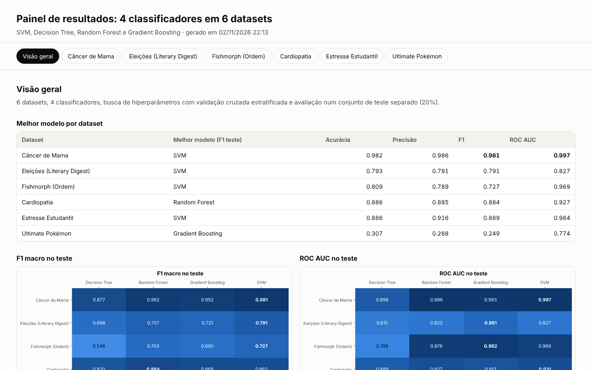
</p>

Cada dataset tem uma aba com indicadores, a tabela de métricas de teste e de validação cruzada, o comparativo em barras e a curva ROC dos quatro modelos:

<table>
  <tr>
    <td width="76%" valign="top">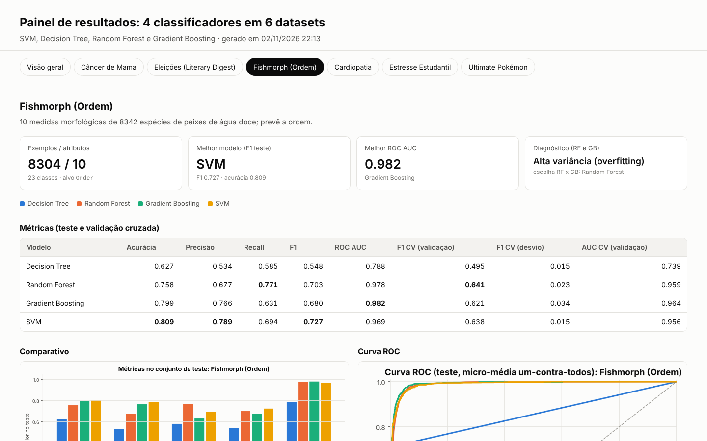</td>
    <td width="24%" valign="top">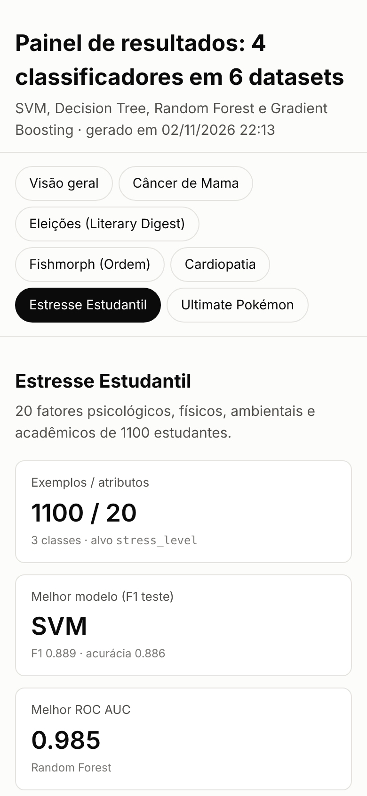</td>
  </tr>
  <tr>
    <td align="center"><sub>Computador (1440 x 900)</sub></td>
    <td align="center"><sub>Celular (390 x 844)</sub></td>
  </tr>
</table>

Matrizes de confusão dos quatro modelos, normalizadas por linha (aqui, os 18 tipos de Pokémon):

<p align="center">
  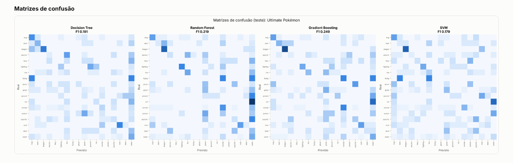
</p>

O diagnóstico de cada dataset traz a justificativa da escolha e as curvas de aprendizado do Random Forest e do Gradient Boosting:

<p align="center">
  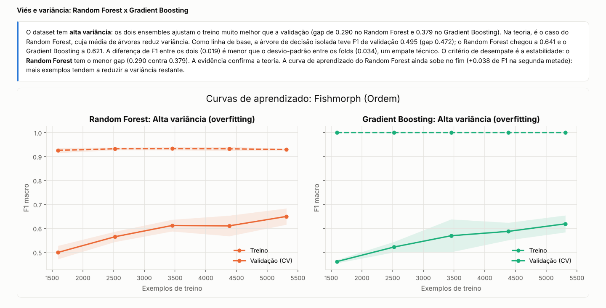
</p>

<table>
  <tr>
    <td width="50%" valign="top">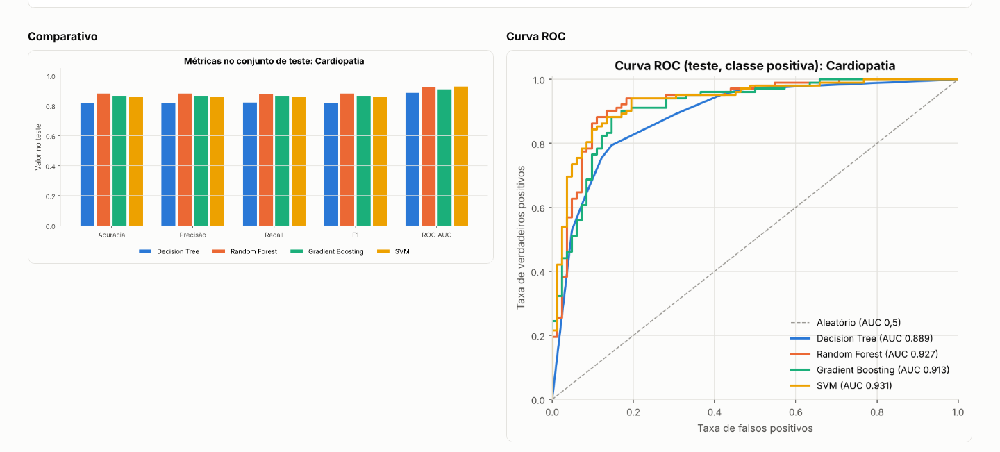</td>
    <td width="50%" valign="top">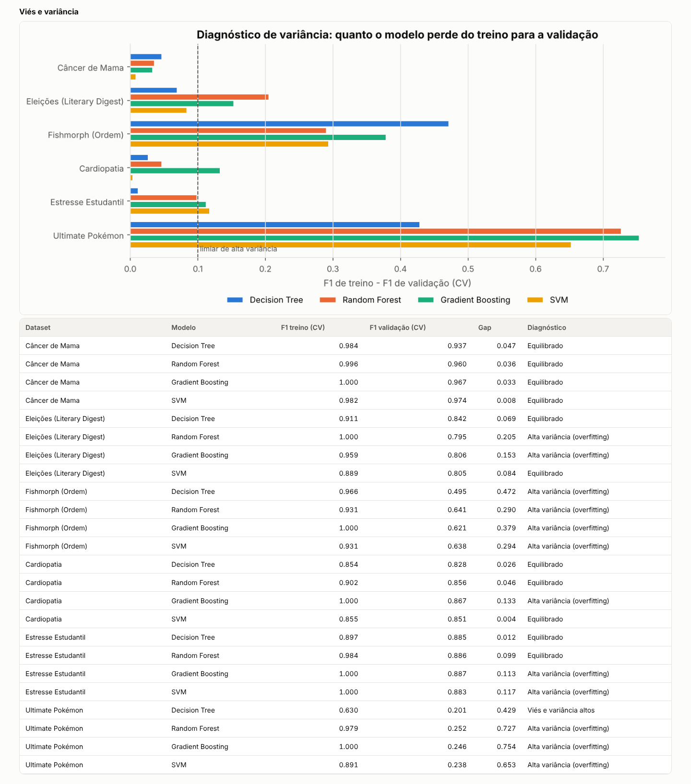</td>
  </tr>
  <tr>
    <td align="center"><sub>Comparativo e curva ROC (Cardiopatia)</sub></td>
    <td align="center"><sub>Viés e variância em todos os datasets</sub></td>
  </tr>
</table>

Saída da execução completa no terminal:

<p align="center">
  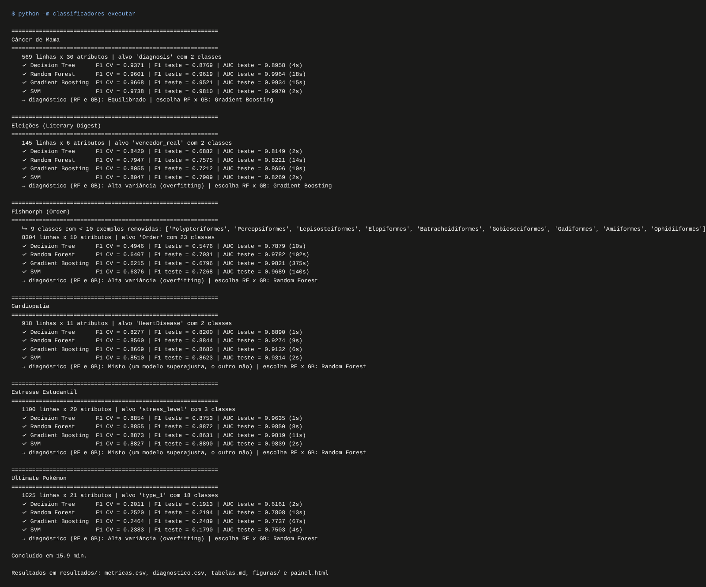
</p>

---

## Arquitetura

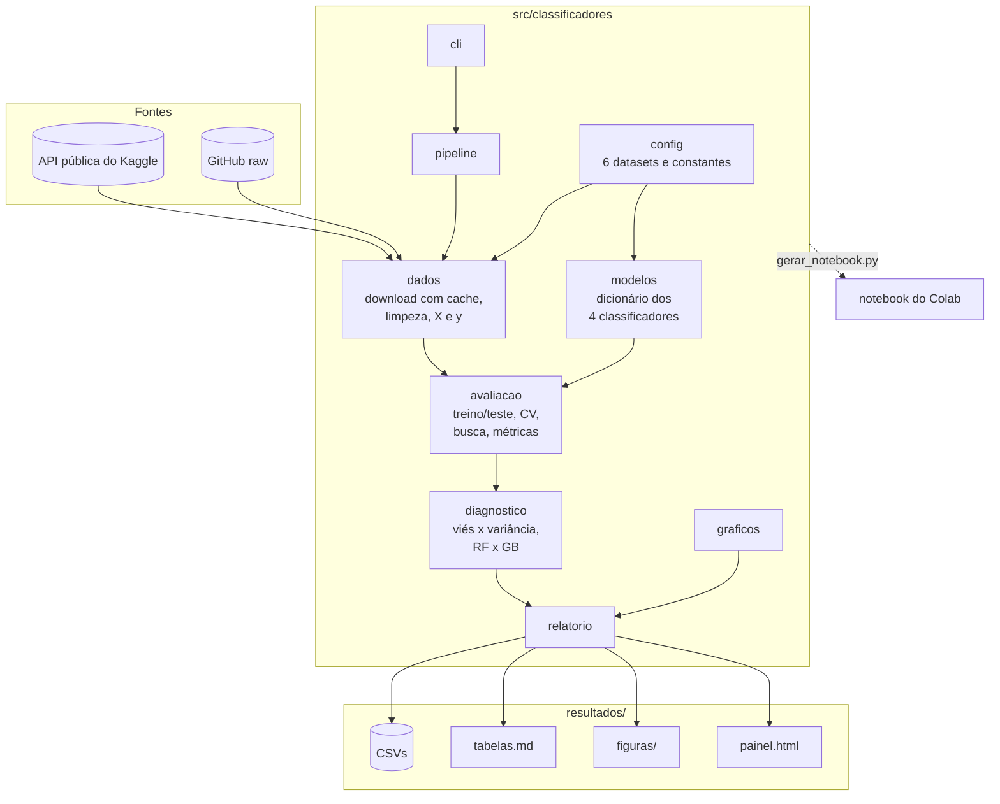

O núcleo é o dicionário de `modelos.py`, percorrido com um único `for` em `avaliacao.py`:

```python
for nome_modelo, item in modelos.items():  # o mesmo código para os 4 classificadores
    rm = avaliar_modelo(nome_modelo, item, X_train, y_train, X_test, y_test, cv, n_iter)
```

Os módulos, o fluxo de um dataset e as decisões de projeto estão em [docs/arquitetura.md](docs/arquitetura.md).

---

## Pipeline

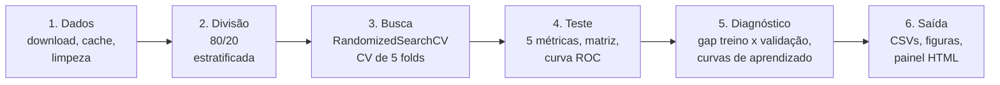

1. **Dados.** Cada CSV é baixado uma vez para `data/raw` (API pública do Kaggle, sem login, ou GitHub), limpo conforme o dataset e separado em `X` e `y`.
2. **Divisão.** 80% para treino e 20% para teste, estratificado pela classe, com semente fixa.
3. **Busca com validação cruzada automática.** `RandomizedSearchCV` sorteia 10 combinações de hiperparâmetros por modelo e avalia cada uma em 5 folds estratificados. A escolha usa o F1 macro, e as 5 métricas são registradas em treino e em validação.
4. **Teste.** O melhor modelo é reajustado no treino inteiro e medido no teste: acurácia, precisão, recall, F1, ROC AUC, matriz de confusão e curva ROC.
5. **Diagnóstico.** O gap entre F1 de treino e de validação e as curvas de aprendizado indicam alta variância ou alto viés e decidem entre Random Forest e Gradient Boosting.
6. **Saída.** CSVs, tabelas em Markdown, figuras PNG e o painel HTML.

---

## Metodologia

Resumo abaixo; regras, limiares e fórmulas completas em [docs/metodologia.md](docs/metodologia.md).

**Pré-processamento.** Dentro do `Pipeline`, para não vazar informação do teste: numéricos recebem imputação (média ou mediana, escolhida na busca) e padronização; categóricos recebem imputação pela moda e one-hot.

**Métricas.** Precisão, recall e F1 são médias macro, em que todas as classes pesam igual, porque Fishmorph e Pokémon são desbalanceados. A ROC AUC é a da classe positiva nos problemas binários e a média macro um-contra-todos nos multiclasse. O SVM usa `decision_function` para a ROC, sem `probability=True`.

**Viés e variância.** Para cada modelo, compara-se o F1 médio dos folds de treino com o dos folds de validação:

| Diagnóstico | Regra |
|---|---|
| Alta variância (overfitting) | F1 treino − F1 validação > 0.10 |
| Alto viés (underfitting) | F1 treino < 0.80 |
| Equilibrado | nenhuma das duas |

**Random Forest x Gradient Boosting.** O Random Forest (bagging) tira a média de árvores profundas e reduz **variância**. O Gradient Boosting (boosting) soma árvores rasas que corrigem os erros anteriores e reduz **viés**. O problema do dataset é lido nos dois: se ambos superajustam, a teoria aponta o Random Forest; se ambos não ajustam nem o treino, o Gradient Boosting. Decide o F1 da validação cruzada. No empate técnico (diferença menor que o desvio-padrão entre os folds), vence o de menor gap. A árvore de decisão isolada serve de linha de base, e o teste não entra na decisão.

---

## Datasets

| Dataset | Fonte | Linhas | Alvo | Classes |
|---|---|:---:|---|:---:|
| Câncer de Mama | [Kaggle: ahmedesso/brest-cancer](https://www.kaggle.com/datasets/ahmedesso/brest-cancer) (Breast Cancer Wisconsin) | 569 | `diagnosis` (maligno/benigno) | 2 |
| Eleições (Literary Digest) | [GitHub: Gabriel-SZ-Silva/LiteraryDigestElections](https://github.com/Gabriel-SZ-Silva/LiteraryDigestElections) | 145 | republicano venceu no estado? | 2 |
| Fishmorph (Ordem) | [Kaggle: menegidio/fishmorph-dataset](https://www.kaggle.com/datasets/menegidio/fishmorph-dataset) | 8304 | `Order` | 23 |
| Cardiopatia | [Kaggle: fedesoriano/heart-failure-prediction](https://www.kaggle.com/datasets/fedesoriano/heart-failure-prediction) | 918 | `HeartDisease` | 2 |
| Estresse Estudantil | [Kaggle: rxnach/student-stress-factors](https://www.kaggle.com/datasets/rxnach/student-stress-factors-a-comprehensive-analysis) | 1100 | `stress_level` | 3 |
| Ultimate Pokémon | [Kaggle: darkmatternet/ultimate-pokmon-dataset-2025](https://www.kaggle.com/datasets/darkmatternet/ultimate-pokmon-dataset-2025) | 1025 | `type_1` (tipo primário) | 18 |

Tratamentos específicos de cada um:

- **Eleições:** o resultado real sai das entradas, porque o alvo é derivado dele. Ano e candidatos também saem, porque sozinhos já indicam o vencedor; o modelo usa a pesquisa do Literary Digest e o estado. 1932 quase não tem resultado real e cai fora.
- **Fishmorph:** removidas as 9 ordens com menos de 10 espécies (38 linhas). Para a vertente por família, troque `arquivo` e `target` em `config.py`.
- **Cardiopatia:** colesterol e pressão iguais a 0 viram valor ausente.
- **Pokémon:** só os 21 atributos numéricos de batalha e biologia. Nome, descrição, habilidades e `type_2` praticamente entregam o tipo.

---

## Instalação

Requisitos: Python 3.10 ou superior e cerca de 3 MB para os dados.

```bash
git clone https://github.com/Gabriel-SZ-Silva/classificadores-6-datasets.git
cd classificadores-6-datasets
python -m venv .venv
```

Ative o ambiente virtual:

```bash
# Windows (PowerShell)
.venv\Scripts\Activate.ps1
# Windows (cmd)
.venv\Scripts\activate.bat
# Linux e macOS
source .venv/bin/activate
```

Instale o pacote:

```bash
pip install -e .            # só para executar
pip install -e ".[dev]"     # com testes, lint e captura de telas
```

`pip install -r requirements.txt` instala só as dependências, sem o pacote; nesse caso rode os comandos com `PYTHONPATH=src` (no PowerShell, `$env:PYTHONPATH="src"`).

---

## Uso

### Linha de comando

```bash
python -m classificadores baixar                 # baixa os 6 CSVs para data/raw
python -m classificadores executar               # experimento completo (10 a 15 min)
python -m classificadores executar --n-iter 2 --sem-curvas        # teste rápido (~1 min)
python -m classificadores executar --datasets cancer_mama estresse # só alguns datasets
python -m classificadores executar --gb-classico # GradientBoostingClassifier clássico (bem mais lento)
python -m classificadores relatorio              # regera resultados/ da última execução, sem treinar
```

Nomes aceitos em `--datasets`: `cancer_mama`, `eleicoes`, `fishmorph`, `cardiopatia`, `estresse`, `pokemon`.

A execução cria em `resultados/`:

| Arquivo | Conteúdo |
|---|---|
| `metricas.csv` | 5 métricas de teste, F1 e AUC da validação cruzada, desvio-padrão e tempo, por dataset e modelo |
| `diagnostico.csv` | F1 de treino e de validação, gap e diagnóstico de cada modelo |
| `escolha_rf_gb.csv` | problema do dataset, escolha entre RF e GB e justificativa |
| `hiperparametros.csv` | melhores hiperparâmetros de cada modelo |
| `tabelas.md` | as tabelas comparativas em Markdown |
| `figuras/` | mapas de calor, gaps e, por dataset, métricas, ROC, matrizes de confusão e curvas de aprendizado |
| `painel.html` | o painel interativo |

Sem internet, ou se o Kaggle recusar o download, baixe os CSVs pelos links da tabela de [Datasets](#datasets) e salve em `data/raw/` com o nome original.

### Atalhos com make (Linux, macOS ou Windows com make)

| Comando | O que faz |
|---|---|
| `make install` | cria o `.venv` e instala com as ferramentas de desenvolvimento |
| `make executar` | experimento completo |
| `make rapido` | versão rápida, para testar |
| `make painel` | abre `resultados/painel.html` no navegador |
| `make test` / `make lint` | testes e ruff |
| `make notebook` | regenera o notebook a partir de `src/` |
| `make telas` | recaptura as telas do README |

### Google Colab

Abra [`notebooks/classificadores_6_datasets.ipynb`](notebooks/classificadores_6_datasets.ipynb) no Colab (botão no topo) e use *Ambiente de execução → Executar tudo*. O notebook contém o mesmo código do pacote, exibe tabelas e gráficos inline e, no fim, baixa `resultados.zip`.

### Atualizar README, notebook e telas depois de mudar o código

```bash
python -m classificadores executar | tee execucao.log   # no PowerShell: ... | Tee-Object execucao.log
python scripts/atualizar_readme.py                      # tabelas do README a partir de resultados/
python scripts/gerar_notebook.py                        # notebook a partir de src/
python -m playwright install chromium                   # uma vez
python scripts/capturar_telas.py --log execucao.log     # telas do painel e do terminal
```

---

## Estrutura do projeto

```
classificadores-6-datasets/
├── Makefile                  # Atalhos: install, executar, rapido, painel, test, lint, notebook, telas
├── pyproject.toml            # Pacote, dependências, configuração do pytest e do ruff
├── requirements.txt          # Dependências de execução
├── requirements-dev.txt      # + pytest, ruff, playwright
├── src/classificadores/
│   ├── config.py             # Constantes e os 6 datasets (alvo, colunas, pré-tratamento)
│   ├── dados.py              # Download com cache, limpeza, X e y
│   ├── modelos.py            # Pré-processamento e o dicionário dos 4 classificadores
│   ├── avaliacao.py          # Treino/teste, CV estratificada, RandomizedSearchCV, métricas, ROC
│   ├── diagnostico.py        # Viés x variância, curvas de aprendizado, escolha RF x GB
│   ├── graficos.py           # Matrizes de confusão, ROC, curvas, mapas de calor
│   ├── relatorio.py          # CSVs, tabelas.md, figuras e painel.html
│   ├── pipeline.py           # Laço sobre os 6 datasets
│   └── cli.py                # python -m classificadores baixar | executar
├── notebooks/
│   └── classificadores_6_datasets.ipynb   # Notebook do Colab, gerado a partir de src/
├── scripts/
│   ├── gerar_notebook.py     # Gera o notebook a partir dos módulos
│   ├── atualizar_readme.py   # Injeta as tabelas de resultados/ no README
│   └── capturar_telas.py     # Capturas do painel com Playwright
├── resultados/               # Saída da última execução (versionada)
├── data/raw/                 # Cache dos CSVs (fora do git)
├── docs/
│   ├── arquitetura.md        # Módulos, fluxo de um dataset, decisões de projeto
│   ├── metodologia.md        # Preparação, validação, métricas, regras do diagnóstico
│   └── assets/telas/         # Capturas usadas neste README
├── tests/                    # Testes com dados sintéticos (sem internet)
└── .github/workflows/ci.yml  # Lint e testes a cada push
```

---

## Testes e qualidade

```bash
pytest -q                      # 20 testes, dados sintéticos, sem internet
ruff check src tests scripts   # lint
```

Os testes cobrem a preparação de cada tipo de dataset, a validação cruzada com classes raras, a ROC AUC binária e multiclasse (inclusive com `decision_function` do SVM), o laço dos 4 modelos com as 5 métricas, as regras do diagnóstico e a geração de todos os arquivos de saída. O GitHub Actions roda lint e testes em Python 3.10 e 3.12 a cada push.

---

## Limitações

- **Datasets pequenos têm estimativas instáveis.** Em Eleições o teste tem só 29 linhas, e uma linha muda a acurácia em 3.4 pontos. Por isso a escolha entre modelos usa a validação cruzada, e não o teste.
- **10 combinações por modelo.** A busca aleatória é um compromisso com o tempo de execução. Mais iterações (`--n-iter`) podem melhorar alguns modelos.
- **Limiares do diagnóstico.** 0.10 de gap e 0.80 de F1 de treino são convenções do projeto, ajustáveis em `config.py`, e não valores universais.
- **Gradient Boosting com histogramas.** O padrão é o `HistGradientBoostingClassifier`, pelo tempo. `--gb-classico` usa o `GradientBoostingClassifier`.
- **Pokémon só com atributos numéricos.** Sem habilidades e sem o segundo tipo, o problema fica difícil de propósito. O F1 baixo reflete o limite desses atributos.
- **Download do Kaggle sem login.** A API pública aceita hoje downloads anônimos de datasets públicos. Se isso mudar, o pacote tenta o `kagglehub` (`pip install -e ".[kaggle]"`) e, por fim, pede o arquivo em `data/raw/`.

---

## Licença

[MIT](LICENSE). Os datasets pertencem aos seus autores e seguem as licenças indicadas nas páginas de origem.
