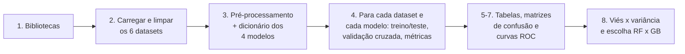
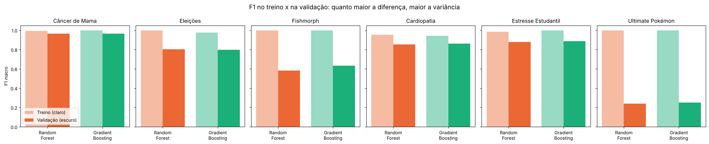
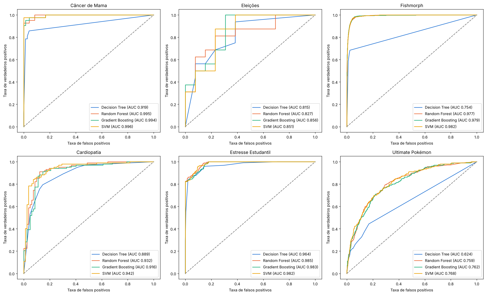
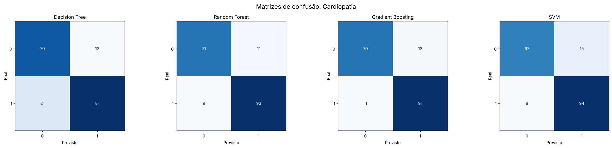
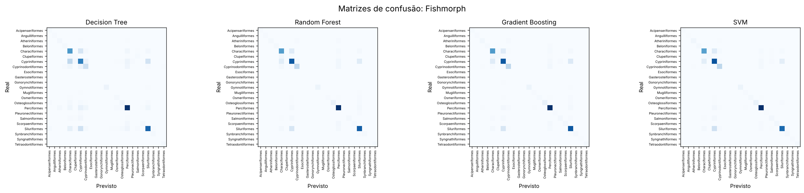

# Classificadores em 6 datasets

Comparação de **SVM, Decision Tree, Random Forest e Gradient Boosting** em seis datasets, com validação cruzada,
métricas de avaliação (acurácia, precisão, F1, curva ROC/AUC e matriz de confusão) e uma análise de **viés e
variância** para escolher entre Random Forest e Gradient Boosting.

Todo o código está num único notebook: [`classificadores_6_datasets.ipynb`](classificadores_6_datasets.ipynb).

[](https://colab.research.google.com/github/Gabriel-SZ-Silva/classificadores-6-datasets/blob/main/classificadores_6_datasets.ipynb)

## Sumário

- [Datasets](#datasets)
- [Como o código funciona](#como-o-código-funciona)
- [Como executar](#como-executar)
- [Resultados](#resultados)
- [Viés e variância: Random Forest ou Gradient Boosting?](#viés-e-variância-random-forest-ou-gradient-boosting)
- [Prints](#prints)
- [Estrutura do repositório](#estrutura-do-repositório)

## Datasets

| Dataset | Fonte | Linhas | O que o modelo prevê | Classes |
|---|---|:---:|---|:---:|
| Câncer de Mama | [Kaggle](https://www.kaggle.com/datasets/ahmedesso/brest-cancer) | 569 | tumor maligno ou benigno (`diagnosis`) | 2 |
| Eleições | [GitHub](https://github.com/Gabriel-SZ-Silva/LiteraryDigestElections) | 145 | se o republicano venceu no estado | 2 |
| Fishmorph | [Kaggle](https://www.kaggle.com/datasets/menegidio/fishmorph-dataset) | 8304 | ordem do peixe (`Order`) | 23 |
| Cardiopatia | [Kaggle](https://www.kaggle.com/datasets/fedesoriano/heart-failure-prediction) | 918 | doença cardíaca (`HeartDisease`) | 2 |
| Estresse Estudantil | [Kaggle](https://www.kaggle.com/datasets/rxnach/student-stress-factors-a-comprehensive-analysis) | 1100 | nível de estresse (`stress_level`) | 3 |
| Ultimate Pokémon | [Kaggle](https://www.kaggle.com/datasets/darkmatternet/ultimate-pokmon-dataset-2025) | 1025 | tipo primário (`type_1`) | 18 |

Limpezas feitas em cada um:

- **Câncer de Mama:** saem `id` e uma coluna vazia.
- **Eleições:** o alvo é calculado a partir do resultado real, que por isso sai das entradas. Também saem o ano e os candidatos, que sozinhos já indicam o vencedor. 1932 quase não tem resultado real e fica de fora.
- **Fishmorph:** saem as ordens com menos de 10 espécies (9 ordens, 38 linhas). Com tão poucos exemplos não dá para dividir em treino, teste e 5 folds.
- **Cardiopatia:** colesterol e pressão iguais a 0 significam "não medido" e viram valor ausente.
- **Pokémon:** só os 21 atributos numéricos (vida, ataque, defesa, peso, altura etc.). Nome, descrição e habilidades entregariam o tipo.

## Como o código funciona

O notebook segue esta ordem:



| Seção | O que faz |
|---|---|
| 1. Bibliotecas | importa pandas, numpy, matplotlib e scikit-learn |
| 2. Datasets | baixa cada CSV e, com uma função `carregar_dataset`, limpa os dados e separa `X` (atributos) e `y` (alvo) |
| 3. Pré-processamento e modelos | dentro de um `Pipeline`: números recebem imputação pela mediana e padronização; textos, imputação pela moda e one-hot. Os 4 classificadores ficam num **dicionário** `nome → (modelo, hiperparâmetros)` |
| 4. Treino e métricas | um **laço `for`** sobre os datasets e, dentro dele, um laço `for` sobre o dicionário de modelos. Para cada par: divisão **80/20 estratificada**, `RandomizedSearchCV` com **validação cruzada de 5 folds** (10 combinações de hiperparâmetros, critério F1), avaliação no teste |
| 5. Tabelas | acurácia, precisão, F1 e ROC AUC no teste, com o melhor modelo em destaque |
| 6. Matrizes de confusão | uma por modelo, para cada dataset |
| 7. Curvas ROC | os 4 modelos de cada dataset no mesmo gráfico |
| 8. Viés e variância | compara F1 de treino e de validação, classifica cada modelo e escolhe entre Random Forest e Gradient Boosting |

O núcleo do código é este laço:

```python
for nome_ds, (X, y) in datasets.items():
    X_train, X_test, y_train, y_test = train_test_split(X, y, test_size=0.2, stratify=y, random_state=42)
    cv = StratifiedKFold(n_splits=5, shuffle=True, random_state=42)

    for nome_modelo, (modelo, parametros) in modelos.items():
        pipeline = Pipeline([("prep", preprocessador), ("modelo", modelo)])
        busca = RandomizedSearchCV(pipeline, parametros, n_iter=10, cv=cv, scoring="f1_macro",
                                   return_train_score=True, n_jobs=-1, random_state=42)
        busca.fit(X_train, y_train)
        ...
```

Detalhes:

- **Precisão e F1** usam a média *macro*, em que todas as classes pesam igual, porque Fishmorph e Pokémon têm classes com poucos exemplos.
- **ROC AUC** nos datasets com mais de 2 classes é a média "um contra todos".
- **Gradient Boosting:** é usado o `HistGradientBoostingClassifier`, a versão rápida do Gradient Boosting no scikit-learn. O `GradientBoostingClassifier` comum levaria mais de 20 minutos só no Fishmorph.

## Como executar

### No Google Colab (mais fácil)

1. Clique no botão **Open in Colab** acima.
2. Menu *Ambiente de execução → Executar tudo*.
3. Espere uns 10 minutos. Os resultados aparecem no próprio notebook e são salvos na pasta `resultados/` do Colab.

Os dados são baixados automaticamente (Kaggle e GitHub, sem login). Se um download falhar, baixe o CSV pelo link da tabela de datasets, envie para o Colab (ícone de pasta → *Fazer upload*) e troque a URL no notebook pelo nome do arquivo, por exemplo `"heart.csv"`.

### No computador

Requisitos: Python 3.10 ou mais novo.

```bash
git clone https://github.com/Gabriel-SZ-Silva/classificadores-6-datasets.git
cd classificadores-6-datasets
python -m venv .venv
.venv\Scripts\activate        # Windows (no Linux/macOS: source .venv/bin/activate)
pip install -r requirements.txt
jupyter notebook classificadores_6_datasets.ipynb
```

No Jupyter, use *Run → Run All Cells*.

## Resultados

Medidos no conjunto de **teste** (20% de cada dataset, separados antes do treino). Em negrito, o melhor modelo de cada dataset.

### F1

| Dataset | Decision Tree | Random Forest | Gradient Boosting | SVM |
|---|:---:|:---:|:---:|:---:|
| Câncer de Mama | 0.903 | 0.971 | 0.952 | **0.981** |
| Eleições | 0.688 | 0.757 | 0.721 | **0.824** |
| Fishmorph | 0.460 | 0.636 | **0.695** | 0.694 |
| Cardiopatia | 0.820 | **0.890** | 0.873 | 0.872 |
| Estresse Estudantil | 0.875 | 0.887 | 0.868 | **0.888** |
| Ultimate Pokémon | 0.182 | 0.194 | 0.250 | **0.266** |

### Acurácia

| Dataset | Decision Tree | Random Forest | Gradient Boosting | SVM |
|---|:---:|:---:|:---:|:---:|
| Câncer de Mama | 0.912 | 0.974 | 0.956 | **0.982** |
| Eleições | 0.690 | 0.759 | 0.724 | **0.828** |
| Fishmorph | 0.630 | 0.792 | 0.795 | **0.801** |
| Cardiopatia | 0.821 | **0.891** | 0.875 | 0.875 |
| Estresse Estudantil | 0.873 | **0.886** | 0.868 | **0.886** |
| Ultimate Pokémon | 0.220 | 0.263 | 0.302 | **0.332** |

### Precisão

| Dataset | Decision Tree | Random Forest | Gradient Boosting | SVM |
|---|:---:|:---:|:---:|:---:|
| Câncer de Mama | 0.921 | 0.980 | 0.961 | **0.986** |
| Eleições | 0.715 | 0.757 | 0.721 | **0.828** |
| Fishmorph | 0.486 | **0.813** | 0.763 | 0.737 |
| Cardiopatia | 0.820 | **0.891** | 0.874 | 0.878 |
| Estresse Estudantil | 0.885 | 0.889 | 0.870 | **0.913** |
| Ultimate Pokémon | 0.180 | 0.189 | **0.270** | 0.267 |

### ROC AUC

| Dataset | Decision Tree | Random Forest | Gradient Boosting | SVM |
|---|:---:|:---:|:---:|:---:|
| Câncer de Mama | 0.919 | 0.995 | 0.994 | **0.996** |
| Eleições | 0.815 | 0.827 | **0.856** | 0.851 |
| Fishmorph | 0.754 | 0.977 | 0.979 | **0.982** |
| Cardiopatia | 0.889 | 0.932 | 0.916 | **0.942** |
| Estresse Estudantil | 0.964 | **0.985** | 0.983 | 0.982 |
| Ultimate Pokémon | 0.624 | 0.759 | 0.762 | **0.768** |

Resumo: o **SVM** teve o melhor F1 em 4 dos 6 datasets. O **Random Forest** venceu em Cardiopatia e o **Gradient Boosting** no Fishmorph. No Pokémon todos ficam com F1 baixo (no máximo 0.266), porque só com atributos numéricos é difícil adivinhar o tipo.

Todos os números estão em [`resultados/metricas.csv`](resultados/metricas.csv).

## Viés e variância: Random Forest ou Gradient Boosting?

Para cada modelo, comparamos o F1 no **treino** com o F1 na **validação** (média dos 5 folds da validação cruzada). A diferença entre os dois é o **gap**:

- **Alta variância (overfitting):** gap maior que 0.10. O modelo decorou o treino e generaliza pior.
- **Alto viés (underfitting):** F1 de treino abaixo de 0.80. O modelo é simples demais e erra até no treino.
- **Equilibrado:** nenhuma das duas situações.

| Dataset | Modelo | F1 treino | F1 validação | Gap | Diagnóstico |
|---|---|:---:|:---:|:---:|---|
| Câncer de Mama | Decision Tree | 0.960 | 0.924 | 0.036 | Equilibrado |
| Câncer de Mama | Random Forest | 0.993 | 0.965 | 0.028 | Equilibrado |
| Câncer de Mama | Gradient Boosting | 1.000 | 0.964 | 0.036 | Equilibrado |
| Câncer de Mama | SVM | 0.985 | 0.974 | 0.011 | Equilibrado |
| Eleições | Decision Tree | 0.911 | 0.842 | 0.069 | Equilibrado |
| Eleições | Random Forest | 1.000 | 0.803 | 0.197 | Alta variância (overfitting) |
| Eleições | Gradient Boosting | 0.976 | 0.797 | 0.179 | Alta variância (overfitting) |
| Eleições | SVM | 0.862 | 0.804 | 0.058 | Equilibrado |
| Fishmorph | Decision Tree | 0.805 | 0.426 | 0.379 | Alta variância (overfitting) |
| Fishmorph | Random Forest | 0.999 | 0.583 | 0.416 | Alta variância (overfitting) |
| Fishmorph | Gradient Boosting | 1.000 | 0.633 | 0.367 | Alta variância (overfitting) |
| Fishmorph | SVM | 0.777 | 0.658 | 0.119 | Alta variância (overfitting) |
| Cardiopatia | Decision Tree | 0.854 | 0.828 | 0.026 | Equilibrado |
| Cardiopatia | Random Forest | 0.954 | 0.853 | 0.101 | Alta variância (overfitting) |
| Cardiopatia | Gradient Boosting | 0.943 | 0.862 | 0.081 | Equilibrado |
| Cardiopatia | SVM | 0.893 | 0.856 | 0.037 | Equilibrado |
| Estresse Estudantil | Decision Tree | 0.897 | 0.885 | 0.012 | Equilibrado |
| Estresse Estudantil | Random Forest | 0.985 | 0.880 | 0.105 | Alta variância (overfitting) |
| Estresse Estudantil | Gradient Boosting | 1.000 | 0.888 | 0.112 | Alta variância (overfitting) |
| Estresse Estudantil | SVM | 0.923 | 0.876 | 0.047 | Equilibrado |
| Ultimate Pokémon | Decision Tree | 0.591 | 0.198 | 0.392 | Alta variância (overfitting) |
| Ultimate Pokémon | Random Forest | 1.000 | 0.240 | 0.760 | Alta variância (overfitting) |
| Ultimate Pokémon | Gradient Boosting | 1.000 | 0.252 | 0.748 | Alta variância (overfitting) |
| Ultimate Pokémon | SVM | 0.759 | 0.233 | 0.526 | Alta variância (overfitting) |

Isso ajuda a escolher entre os dois ensembles de árvores:

- **Random Forest** (bagging) tira a média de muitas árvores profundas, o que **reduz a variância**.
- **Gradient Boosting** (boosting) soma árvores pequenas em sequência, cada uma corrigindo o erro da anterior, o que **reduz o viés**.

Regra usada: se os dois ensembles têm alta variância, a teoria indica o Random Forest; se os dois têm alto viés, o Gradient Boosting. A escolha final é de quem teve o maior F1 na validação. Se a diferença for menor que 0.02 (empate), vence o de menor gap, isto é, o que perde menos do treino para a validação.

| Dataset | Problema | Gap RF | Gap GB | F1 validação RF | F1 validação GB | Escolha | Motivo |
|---|---|:---:|:---:|:---:|:---:|---|---|
| Câncer de Mama | sem problema dominante | 0.028 | 0.036 | 0.965 | 0.964 | **Random Forest** | empate na validação (diferença de 0.000); vence o de menor gap |
| Eleições | alta variância | 0.197 | 0.179 | 0.803 | 0.797 | **Gradient Boosting** | empate na validação (diferença de 0.006); vence o de menor gap |
| Fishmorph | alta variância | 0.416 | 0.367 | 0.583 | 0.633 | **Gradient Boosting** | maior F1 na validação (diferença de 0.050) |
| Cardiopatia | sem problema dominante | 0.101 | 0.081 | 0.853 | 0.862 | **Gradient Boosting** | empate na validação (diferença de 0.009); vence o de menor gap |
| Estresse Estudantil | alta variância | 0.105 | 0.112 | 0.880 | 0.888 | **Random Forest** | empate na validação (diferença de 0.009); vence o de menor gap |
| Ultimate Pokémon | alta variância | 0.760 | 0.748 | 0.240 | 0.252 | **Gradient Boosting** | empate na validação (diferença de 0.012); vence o de menor gap |

<p align="center"></p>

O que os resultados mostram:

- **Nenhum dataset teve alto viés nos ensembles.** Random Forest e Gradient Boosting chegam perto de F1 1.0 no treino em quase todos. O problema que aparece é a **variância**.
- **Fishmorph e Pokémon** têm a maior variância: os modelos acertam quase tudo no treino e muito menos na validação.
- **Na maioria dos casos o Gradient Boosting foi escolhido**, mesmo quando a teoria indicava o Random Forest. Com a regularização L2 e os hiperparâmetros escolhidos na busca, ele também controlou a variância. Isso mostra que a teoria é um ponto de partida e que a validação cruzada decide.
- **Em quase todos os datasets RF e GB empataram na validação** (diferença menor que 0.02). A exceção foi o Fishmorph, onde o Gradient Boosting foi claramente melhor.

## Prints

### Curvas ROC

<p align="center"></p>

### Matrizes de confusão

<p align="center"></p>

<p align="center"></p>

<p align="center"></p>

<p align="center"></p>

<p align="center"></p>

<p align="center"></p>

As saídas completas, com todas as tabelas, aparecem abrindo o [notebook](classificadores_6_datasets.ipynb) aqui no GitHub.

## Estrutura do repositório

```
classificadores-6-datasets/
├── classificadores_6_datasets.ipynb   # todo o código (com as saídas da última execução)
├── requirements.txt                   # bibliotecas necessárias
├── resultados/
│   ├── metricas.csv                   # métricas de teste, F1 de treino e validação, gap e diagnóstico
│   ├── escolha_rf_gb.csv              # escolha entre Random Forest e Gradient Boosting
│   └── figuras/                       # matrizes de confusão, curvas ROC, treino x validação
├── LICENSE
└── README.md
```

## Licença

[MIT](LICENSE). Os datasets pertencem aos seus autores.
