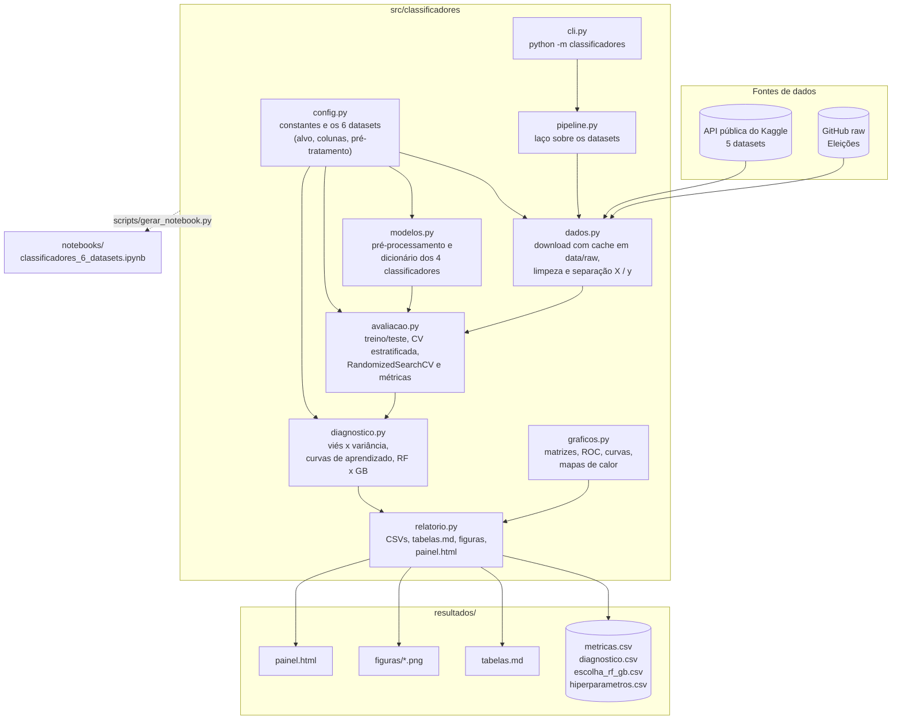
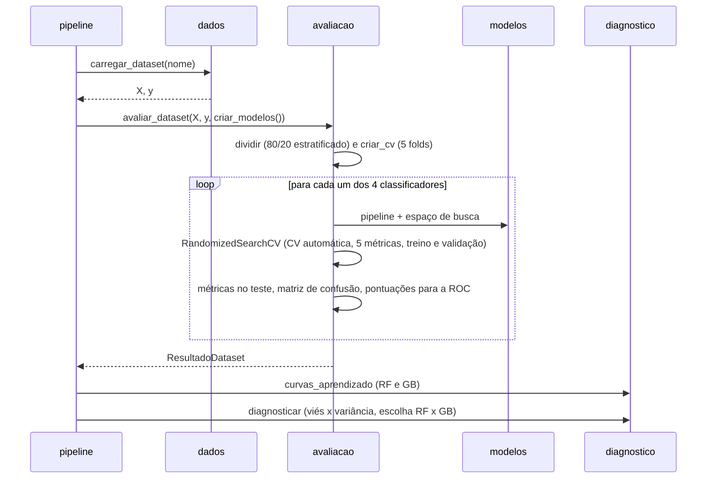

# Arquitetura

O projeto é um pacote Python (`src/classificadores`) com uma linha de comando e um notebook do Colab gerado a partir do mesmo código. Cada módulo tem uma responsabilidade.

## Módulos

| Módulo | O que faz |
|---|---|
| `config.py` | Constantes do experimento (semente, tamanho do teste, folds, iterações da busca, limiares do diagnóstico) e a descrição de cada dataset: origem, coluna-alvo, colunas usadas ou removidas e a função de pré-tratamento. |
| `dados.py` | Lê o CSV do cache `data/raw`; se faltar, baixa da API pública do Kaggle ou do GitHub e guarda no cache. Remove linhas sem rótulo e classes raras e separa `X` e `y`. |
| `modelos.py` | Monta o `ColumnTransformer` (imputação, escala e one-hot) e devolve **um dicionário** com os 4 classificadores, cada um com o seu `Pipeline` e o seu espaço de hiperparâmetros. |
| `avaliacao.py` | Divide treino e teste, cria a validação cruzada estratificada, roda o `RandomizedSearchCV` com várias métricas ao mesmo tempo e calcula as métricas de teste, a matriz de confusão e a curva ROC. Percorre o dicionário de modelos com um único `for`. |
| `diagnostico.py` | Classifica cada modelo como alta variância, alto viés ou equilibrado, gera as curvas de aprendizado do Random Forest e do Gradient Boosting e escreve a justificativa da escolha entre os dois. |
| `graficos.py` | Todas as figuras, com a mesma cor para cada modelo em todos os gráficos. |
| `relatorio.py` | Tabelas comparativas (CSV e Markdown), figuras em PNG e o painel HTML de arquivo único. |
| `pipeline.py` | Percorre os 6 datasets e chama as etapas acima. |
| `cli.py` | Comandos `baixar` e `executar`. |

## Fluxo de um dataset

## Decisões de projeto

- **Pré-processamento dentro do `Pipeline`.** Imputação, escala e one-hot são ajustados só nos folds de treino de cada validação cruzada, o que evita vazamento de dados.
- **Uma divisão treino/teste por dataset.** O conjunto de teste é separado uma vez e só é usado no fim; a escolha de hiperparâmetros e o diagnóstico usam apenas a validação cruzada.
- **Métricas macro.** Precisão, recall e F1 são médias macro (todas as classes pesam igual), porque Fishmorph e Pokémon são desbalanceados.
- **ROC sem `probability=True` no SVM.** A curva ROC só depende da ordem das pontuações, então o SVM usa `decision_function`. Isso evita a validação cruzada interna que o `probability=True` faria e deixa o SVM várias vezes mais rápido.
- **`HistGradientBoostingClassifier`.** É gradient boosting de árvores, como o `GradientBoostingClassifier`, mas usa histogramas. No Fishmorph a versão clássica leva cerca de 1 minuto por ajuste, contra 3 segundos. A clássica continua disponível com `--gb-classico`.
- **Notebook gerado, não copiado.** `scripts/gerar_notebook.py` transforma cada módulo em uma célula. O notebook do Colab e o pacote não divergem.
